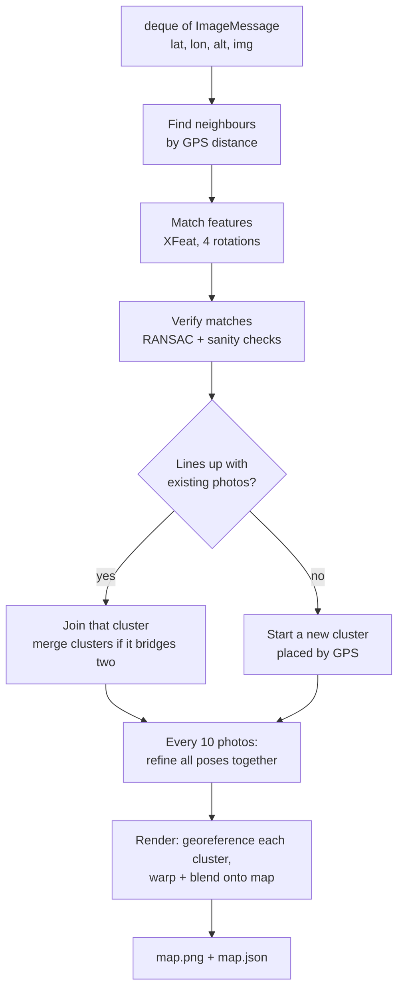

# Image Stitcher: How It Works

A full explanation of the 3DS groundside image stitcher (issue
[#179](https://github.com/UWARG/autonomy-monorepo/issues/179), PR
[#215](https://github.com/UWARG/autonomy-monorepo/pull/215)). It assumes no
computer vision background. For quick usage, see [README.md](README.md).

---

## 1. The problem

The 3DS project maps an area using several drones at once. Each drone flies
back and forth over its part of the area (a "lawn mower" pattern) and takes
photos looking straight down. The ground station has to combine all of
those photos into **one top-down map** of the whole area. That map is called
an **orthomosaic**.

What makes this hard:

- **Photos arrive in any order.** Several drones send photos at the same time,
  so two photos that arrive one after the other may be from opposite ends of
  the field.
- **GPS is imprecise.** Each photo comes with the drone's GPS position, but
  consumer GPS is often off by 1 to 3 metres. A photo 2 m out of place shows
  up as an obvious "ghost": roads and buildings appear doubled.
- **Nothing else is known about the photo.** The message has only latitude,
  longitude, altitude and the image. There's no compass heading (which way
  the drone was facing) and no camera field of view (how much ground a photo
  covers).
- **Drones turn around.** On a lawn mower path the drone flips 180° at the end
  of every row, so neighbouring photos can be upside down relative to each
  other.

## 2. The idea in one paragraph

GPS is good enough to say *roughly* where a photo belongs, but not to line
photos up precisely. The pictures themselves can line up precisely: if two
photos overlap, the same corner of the same building appears in both, and
the exact shift, rotation and size difference between the photos can be
measured from that. So the stitcher uses **GPS to find which photos overlap**,
**image matching to line them up with each other**, and then **all the GPS
readings together** to place the finished map on the Earth. Averaging many
GPS readings is much more accurate than trusting any single one.

## 3. The pipeline



Each step is explained below.

### Step 0: Messages and the queue

Each photo arrives as an `ImageMessage` (`message.py`):

| Field | Meaning |
|---|---|
| `lat`, `lon` | Drone GPS position in degrees |
| `alt` | Metres above the launch point |
| `img` | The photo, as a height × width × 3 RGB array |
| `drone_id`, `image_id` | Optional labels, used in logs |

Messages go into a `collections.deque` (a list you can add to at one end
and take from at the other). Whatever receives photos from the drones
appends to it, and the stitcher takes them off one at a time:

- `ImageStitcher.process_queue(queue)` handles everything currently waiting.
- `ImageStitcher.run(queue, stop_event, output_path=...)` keeps watching the
  queue on a background thread, saves the map periodically, and stops when
  `stop_event` is set and the queue is empty.

Photos without a GPS fix (the 3ds camera node writes `NaN` in that case) or
with a malformed image are logged and skipped.

### Step 1: Turn GPS into metres

Latitude and longitude are angles, which are awkward to do geometry with.
The first photo's position becomes the **reference point**, and every GPS
position is converted to **metres east and north** of it (`geo.py`,
`gps_to_local`). Over a few kilometres, treating the Earth as flat is
accurate to well under a metre.

### Step 2: Find likely neighbours

Comparing a new photo with every earlier photo would get slow, and most of
them are nowhere near it. Instead, the stitcher only considers photos whose
GPS position is close enough to overlap the new one (within one photo
diagonal, plus twice the expected GPS error), nearest first, and at most 6
of them (`_neighbours`).

### Step 3: Find matching points with XFeat

[XFeat](https://github.com/verlab/accelerated_features) is a small neural
network (published at CVPR 2024) that finds **keypoints**, distinctive spots
like corners and blobs, and describes each one with 64 numbers (a
**descriptor**). The same spot photographed twice gets nearly the same
descriptor, so keypoints from two photos can be paired up by comparing
descriptors (`features.py`).

XFeat runs on the CPU (it uses a GPU automatically if PyTorch finds one) and
takes a fraction of a second per photo. It is vendored, meaning a copy of
its code and trained weights lives in `third_party/xfeat/`, because it can't
be installed with pip. Its licence (Apache 2.0) allows this, and its
`__init__.py` records exactly which version was copied and what was changed.

**The rotation problem.** XFeat recognises a spot only if the photo is
roughly the same way up. Turned more than about 45°, matching fails. Since
lawn mower rows alternate direction, half the neighbouring photos are
upside down. The fix: features are extracted from each new photo **four
times**, rotated 0°, 90°, 180° and 270°, and the keypoint positions are
converted back to the unrotated photo's coordinates (`unrotate_points`).
Whichever rotation gives the most verified matches is used. Any heading is
within 45° of one of the four.

### Step 4: Verify the matches (RANSAC)

Descriptor pairing always produces some wrong pairs. **RANSAC** (random
sample consensus) removes them: it repeatedly picks a couple of pairs at
random, works out the transform they imply, and counts how many other pairs
agree with it (within 3 pixels). The transform with the most agreement wins,
and only the pairs that agree, the **inliers**, are kept.

The transform is a **similarity**: a shift, a rotation and a uniform scale.
Because the camera points straight down at flat ground, that's exactly how
two overlapping photos relate.

A match is then rejected if:

- **too few inliers**: fewer than 30 means the photos probably don't really
  overlap;
- **wrong scale**: a photo from higher up shows more ground per pixel, so the
  scale between two photos must match the ratio of their altitudes (within
  25%);
- **too far from GPS** (Step 6).

### Step 5: Clusters

A **cluster** is a group of photos already lined up with each other. Each
cluster has its own coordinate system, the pixel grid of its first photo,
and every member stores its **pose**: the transform from its own pixels into
that grid.

When a new photo arrives:

- If it matches photos in one cluster, its pose is fitted from all those
  matches together, and it joins.
- If it matches photos in **two or more** clusters, it acts as a bridge: it
  joins the best one, and the others are merged in by re-expressing their
  poses through the new photo.
- If it matches nothing, it starts a new cluster on its own.

This is what handles out-of-order arrival. Early on, each drone's photos
form separate islands; as the gaps fill in, the islands merge.

### Step 6: Guarding against wrong matches

On repetitive ground (rows of crops, identical roofs), two photos of
*different* places can look the same and pass RANSAC. Once a cluster's
position on the map is well known, a photo trying to join it must land
within 15 m of its own GPS reading, otherwise the match is rejected
(`_agrees_with_gps`).

A small cluster's position isn't well known yet: with two photos 10 m apart
and 3 m GPS error, the cluster itself can be several metres off. Applying the
check to it would reject *good* matches. So a cluster is only trusted for
this check once its photos are spread over at least 4 × the expected GPS
error. One test builds a field whose east half is an exact copy of its west
half, and confirms the stitcher doesn't put east-side photos in the west.

### Step 7: Refinement (removing drift)

Each photo is lined up against photos placed before it. Every placement has
a tiny error, and errors add up along a chain of photos: by the end of a
row, photos have drifted slightly, and where rows meet the map looks
ghosted. This is called **drift**.

`refine.py` fixes it by re-solving **every pose in a cluster at the same
time** so that all matched points agree as well as possible. This is a
simplified form of what mapping software calls **bundle adjustment**.

The trick that keeps it simple: a similarity transform can be written with
four numbers, `a, b, tx, ty`:

```
x' = a·x − b·y + tx
y' = b·x + a·y + ty
```

Every matched point pair says "photo *i*'s transform of point *p* must equal
photo *j*'s transform of point *q*". Those equations are **linear** in the
unknowns, so every match in the cluster stacks into one least-squares
problem that NumPy solves directly, with no iteration. One photo's pose is
held fixed, because the equations only describe how photos sit *relative to
each other*.

It runs every 10 photos and before every render. On the test missions it
reduced photo-to-photo misalignment from 0.15 m to 0.03 m.

### Step 8: Georeferencing (putting each cluster on Earth)

Inside a cluster everything is in pixels. To put it on the map, the stitcher
finds the **single best rotation, scale and shift** that moves the photo
centres onto their GPS positions (`fit_similarity`, Umeyama's method). With
50 photos, 50 noisy GPS readings get averaged, so the cluster's position is
much better than any single reading.

This step also works out what the camera never reported:

- **Scale** (metres per pixel) comes from comparing GPS distances with pixel
  distances. That's why no camera FOV is needed.
- **Heading** comes from the direction photo centres line up in.

Image y points *down* while north points *up*, so the fit is done with y
flipped (`FLIP_Y`) to avoid getting a mirror image.

A cluster with one photo, or whose photos were all taken from about the same
spot, can't be fitted this way. It's placed at its GPS position, assumed to
face north, using the metres-per-pixel learned from other clusters (or a
70° field of view if nothing has been learned yet). It snaps into place once
it merges with a neighbour.

### Step 9: Rendering the map

`canvas.py` paints every photo onto one north-up image in which each pixel
is a fixed patch of ground (by default, the photos' own resolution, about
5.5 cm at 25 m altitude in the tests). The canvas grows as photos land
outside its edges. OpenCV's `warpAffine` does the actual rotating, scaling
and placing.

Where photos overlap, pixels are **blended** with a weighted average. Each
photo's weight is highest in its centre and fades to almost zero at its
edges, so overlaps fade into each other with no visible seams.

The output (`files.py`):

- `map.png`: the map, transparent where no photo covered the ground;
- `map.json`: the GPS coordinates of the image's four corners, metres per
  pixel, size and photo count. This is what makes the map
  **georeferenced**: any pixel can be converted back to a real GPS position.

## 4. Files

| File | What's in it |
|---|---|
| `message.py` | `ImageMessage`, the queue item |
| `stitcher.py` | `ImageStitcher` and `StitcherConfig`: steps 2 and 4–8 and the queue loop |
| `features.py` | `XFeatMatcher`: step 3, including the four-rotation trick |
| `refine.py` | `refine_poses`: step 7 |
| `canvas.py` | `Canvas`: step 9, the growing map and blending |
| `geo.py` | GPS ↔ metres, transforms, `fit_similarity` |
| `files.py` | Writing `map.png`/`map.json`; reading photo runs saved by the 3ds airside camera node |
| `synthetic.py` | Fake missions with known ground truth, for tests and the demo |
| `demo.py` | Runs a fake 3-drone mission end to end |
| `third_party/xfeat/` | Vendored XFeat code, weights and licence |

## 5. Testing

There are no real drone photos yet, so the stitcher is tested with
**simulated missions** (`synthetic.py`):

1. Generate a random ground texture (noise, circles, rectangles, lines) that
   stands in for a field, e.g. 120 × 90 m.
2. Fly virtual drones over it on lawn mower paths: for each photo position,
   cut out what a downward camera at that altitude and heading would see.
3. Add realistic errors to what's *reported*: GPS noise, altitude noise,
   heading wobble. Split rows between several drones and shuffle the arrival
   order.
4. Because every photo's true position is known, the stitcher's result can be
   measured exactly.

Two numbers are measured:

- **Relative error**: how well photos line up *with each other*. This is
  what you see as sharpness vs ghosting.
- **Absolute error**: how far the map is from its true position on Earth.

Results (simulated only, 120 × 90 m field, 50 photos, 3 drones, shuffled
arrival, unknown heading, 5 random fields per row):

| GPS error | Relative error | Absolute error | Connected into one map |
|---|---|---|---|
| 1 m | 3–6 cm (about 1 pixel) | 0.15–0.45 m | 5 / 5 |
| 3 m | 3–6 cm (about 1 pixel) | 0.5–1.3 m | 5 / 5 |

Speed: about 0.5 s per photo on a laptop CPU.

The test suite has 30 test cases:

- **Unit tests** (`tests/unit/test_stitcher_*.py`, fast, no XFeat): GPS
  conversions, transforms, the rotation un-mapping, similarity fitting,
  refinement removing drift, canvas placement and growth, message checks, and
  reading/writing files.
- **End-to-end tests** (`tests/integration/test_image_stitcher.py`, real
  XFeat, about 25 s): full multi-drone missions form one map with
  sub-decimetre alignment; resolution is learned without the FOV; the deque
  loop runs, skips bad messages and saves; separate islands merge once the
  gap is photographed; photos at two altitudes merge; repeating ground
  doesn't fool it.

```bash
cd 3DS_Groundside
uv run --extra dev pytest tests/unit          # fast
uv run --extra dev pytest tests/integration   # XFeat end to end
uv run python -m src.image_stitcher.demo out --gps-noise 2   # see a map
```

## 6. Problems hit during development

These shaped the design, and are worth knowing before changing it.

| Problem | Symptom | Fix |
|---|---|---|
| XFeat isn't rotation invariant | Each lawn mower row became its own island: 600 candidate matches between rows, only 6–13 survived RANSAC | Extract features at four quarter turns |
| Drift from chaining placements | 0.15–0.3 m ghosting on a 120 m field | Joint least-squares refinement (Step 7) |
| First refinement version was numerically unstable | Pinning one photo with a huge penalty weight made the solver discard information: errors of 20–30 m | Remove the pinned photo's unknowns from the system entirely |
| Small clusters with noisy GPS | 1 run in 10 split the map: good matches rejected by an unreliable 2-photo cluster | Only trust a cluster for the GPS check once it spans 4 × the GPS error |
| Photos with identical names from different drones | Looking results up by name returned the wrong photo | `placements()` returns results per message, not by name |

## 7. Design decisions

- **GPS for coarse, images for fine.** Neither alone works: GPS-only ghosts,
  and image-only drifts and doesn't know where it is on Earth.
- **No heading or FOV required**, because the PM confirmed they aren't
  available. Both are recovered from the data.
- **XFeat** was chosen by the PM. It's faster than SIFT on CPU and more robust
  than ORB.
- **Vendored XFeat and weights (6 MB)** so it works with no internet at the
  field. The weights were checked byte-for-byte against the official repo and
  load in PyTorch's safe mode, which can't execute code.
- **CPU-only PyTorch** via a uv package index, so CI doesn't download the
  multi-GB CUDA build.
- **Rendering redraws everything** rather than updating in place, because
  refinement and merges move photos that are already on the map.

## 8. Limitations and next steps

- **Flat ground, camera straight down.** Hills, tall buildings and tilted
  photos will misalign slightly. True 3D (milestone M4) needs a different
  approach.
- **No lens distortion correction.** Camera calibration
  ([#212](https://github.com/UWARG/autonomy-monorepo/issues/212)) would let
  photos be undistorted first.
- **Absolute accuracy is limited by GPS.** Averaging helps, but sub-decimetre
  placement on Earth would need ground control points.
- **A photo that overlaps nothing** is placed by GPS facing north until a
  neighbour arrives.
- **Scale.** Fine for hundreds of photos. Thousands would need map tiling and a
  sparse solver for refinement.
- **Not yet tested on real photos**, and not yet connected to the real drone
  comms. `files.load_photo_run` can already read runs saved by the 3ds
  camera node, so a recorded flight is the obvious next test.

## 9. Glossary

| Term | Meaning |
|---|---|
| Orthomosaic | A single top-down map stitched from many photos |
| Nadir | Camera pointing straight down |
| GSD (ground sample distance) | Metres of ground per image pixel |
| Keypoint / descriptor | A distinctive spot in an image / 64 numbers describing it |
| RANSAC | Fitting a model while ignoring wrong data points |
| Inlier | A match that agrees with the fitted transform |
| Similarity transform | Shift + rotation + uniform scale |
| Pose | A photo's transform into its cluster's coordinates |
| Cluster | Photos already lined up with each other |
| Drift | Small placement errors adding up along a chain of photos |
| Bundle adjustment | Re-solving all placements together to remove drift |
| Georeference | Tie an image to real GPS coordinates |
| Vendoring | Copying a third-party library's code into your repo |
