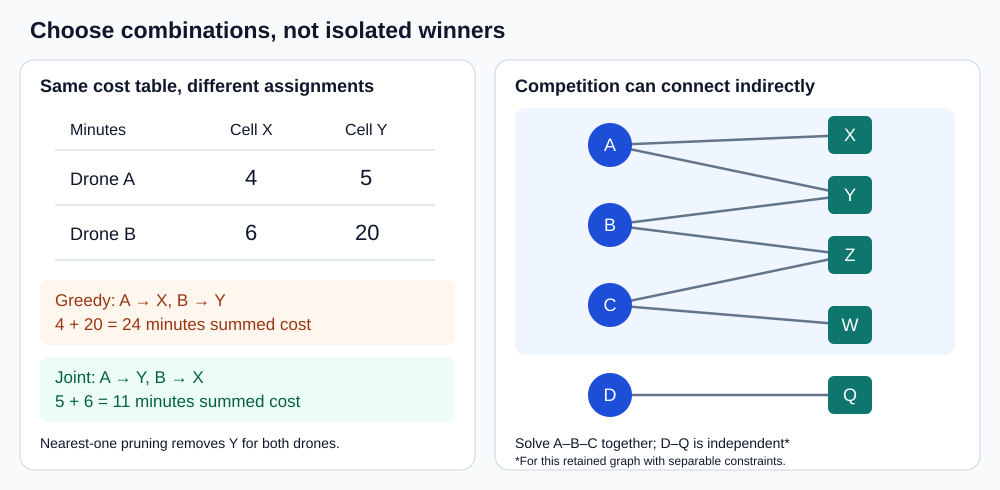
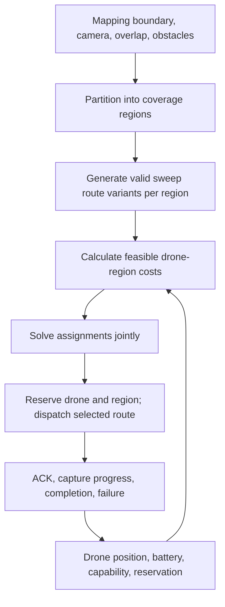
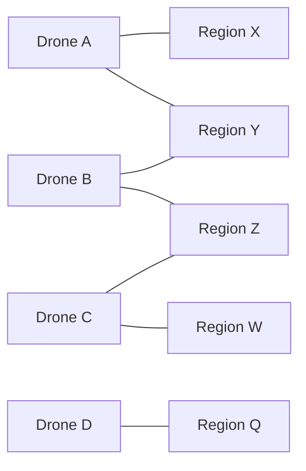
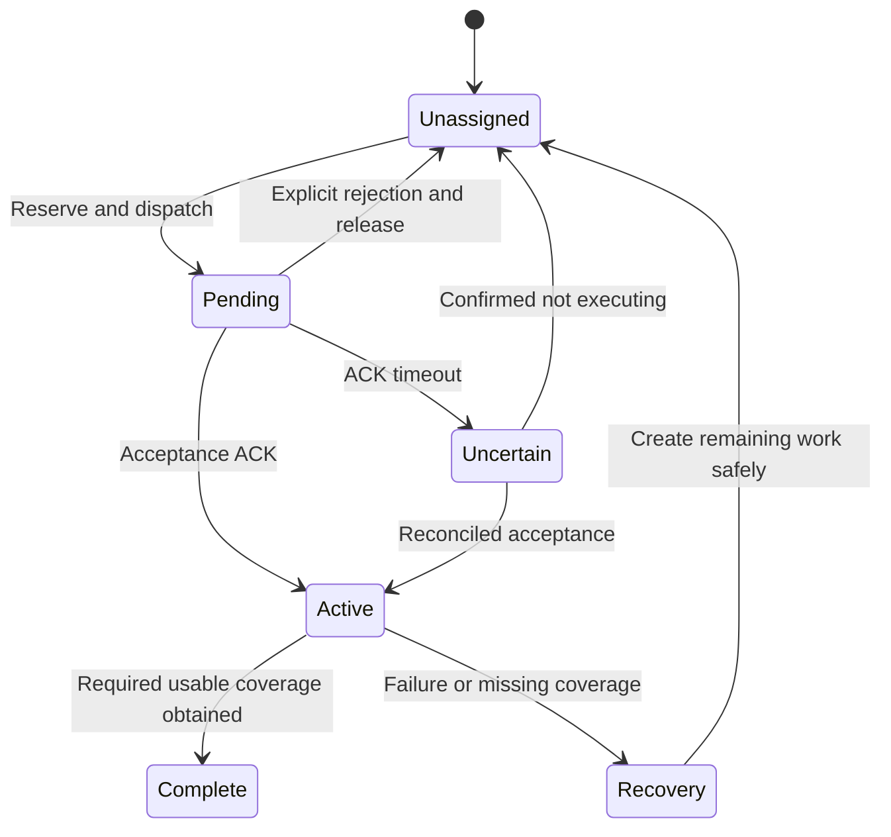

# Swarm coverage: regions, routes, and assignment

Design discussion, 2026-11-01. This is a proposal, not an implemented interface or a flight-ready planner.

## Recommendation

Use the existing coverage planner to expose independently assignable regions and route variants. Start with a full minimum-cost assignment across available drones and unassigned regions. Cache route work and replan on meaningful events. Add spatial candidate filtering only if measurements show it is needed.

The proposed idea—compare drones only where their candidate regions overlap—is useful as **sparse assignment on a bipartite graph**. It is not automatically globally optimal. Solving independent connected components is exact for an additive assignment objective if all relevant feasible edges are retained and there are no cross-component constraints. Restricting candidates to nearby regions can remove the best solution.

H3 is optional. Borrowing cell IDs and adjacency does not require hexagons or the H3 library. Irregular coverage regions form a custom region graph.



## What the related work provides

| Work | Relevant behavior | Extension needed |
| --- | --- | --- |
| [PR #192: coverage planner](https://github.com/UWARG/autonomy-monorepo/pull/192), reviewed at `a4fd32b` | Decomposes polygons, produces sweeps, evaluates orientations, returns a combined route and capture points | Expose individual regions, entry/exit variants, per-region costs and coverage requirements |
| [PR #217: scheduler](https://github.com/UWARG/autonomy-monorepo/pull/217), reviewed at `0b0179d` | Visits missions in queue order and assigns each to the nearest available drone | Separate cost estimation, assignment solving, and command execution |
| [Issue #169](https://github.com/UWARG/autonomy-monorepo/issues/169) | Describes future assignment of cell waypoint queues | Define cell-task ownership and completion |
| [PR #204: benchmark](https://github.com/UWARG/autonomy-monorepo/pull/204) | Generates mapping scenarios and scores progress | Extend with assignment cost, completion time, computation time, and failure scenarios |
| [Issue #226: swarm pathing](https://github.com/UWARG/autonomy-monorepo/issues/226) | Currently a task template | Agree on objectives and interfaces |

PR #192's orientation score is straight sweep length plus a turn penalty. Its returned route length also measures connections in the assembled path. Neither should be treated as a complete drone-specific mission cost. Its optional start influences cell ordering and is prepended to the route; it does not optimize arbitrary entry into every cell.

## Three separate decisions



1. **Partitioning:** What is a useful chunk of work?
2. **Routing:** How should a drone cover that chunk?
3. **Assignment:** Which drone should execute which route?

A better assignment solver cannot recover efficiency lost by splitting a field into badly shaped chunks. Good partitions also cannot prevent a greedy scheduler from choosing poor assignments.

## Choosing regions: H3 versus coverage-shaped tasks

| Method | Benefits | Costs and limitations | Suitable role |
| --- | --- | --- | --- |
| Fixed H3 cells clipped to the mapping area | Stable geographic IDs, neighbour queries, convenient progress aggregation | Artificial boundaries can shorten passes and add turns; clipped fragments may be disconnected; cell sizes do not imply equal work | Geographic bookkeeping; large-area partition baseline |
| Boustrophedon cells | Partitions follow changes in sweep connectivity around boundaries and obstacles | Can produce very unequal workloads; may need splitting or merging | Natural starting point for PR #192 |
| Groups of adjacent sweep strips | Preserve long passes; task duration can be adjusted by strip count | Need custom IDs, boundary handling, and adjacency | Initial fleet task units |
| Adaptive split/merge regions | Adjust workloads to battery, vehicle speed, or remaining coverage | More planning overhead; changing partitions complicates progress tracking | Later improvement when imbalance is measured |
| H3 progress grid with independent flight tasks | Consistent coverage indexing without forcing flights to follow hexagon boundaries | Must map image footprints and task coverage into the index | Optional hybrid |

H3 uses a predefined geographic grid; arbitrary polygons are not H3 cells. It provides logical hierarchy, while geometric containment across resolutions is approximate. Do not assume a parent's exact polygon is the union of its indexed children. [H3 indexing documentation](https://h3geo.org/docs/highlights/indexing/).

```text
One long field sweep             Splitting that sweep into small tasks

  +----------------------+        +-------+-------+-------+
  | >>>>>>>>>>>>>>>>>>>> |        | >>>>> | >>>>> | >>>>> |
  | <<<<<<<<<<<<<<<<<<<< |        | <<<<< | <<<<< | <<<<< |
  | >>>>>>>>>>>>>>>>>>>> |        | >>>>> | >>>>> | >>>>> |
  +----------------------+        +-------+-------+-------+

  Fewer long passes               More independent entries and turns
  Coarser task ownership          Easier redistribution of smaller tasks
```

Schematic only: actual turn counts depend on route geometry. Choose task sizes using estimated execution time, not just equal area. Preserve overlap across region boundaries. Coverage ownership is not a collision-avoidance guarantee: transit, turns, and camera footprints can cross region boundaries even when task polygons are disjoint.

## Entry points and costs

A region should have a small set of **valid route variants**, each with an entry, exit, and complete ordered sweep. Reversing a route or starting at another outer row can give a different variant. Distance to any point inside a region is only a proximity heuristic: being inside the polygon does not mean the drone can begin a complete efficient sweep there.

For drone d, region c, and feasible route variant v:

```text
cost[d,c] = min over v (
    travel_time(drone_position[d], entry[c,v])
  + sweep_time[d,c,v]
  + turn_time[d,c,v]
  + capture_and_settling_time[d,c,v]
)
```

Do not double-count turn or capture time if the sweep estimate already includes it. Save the minimizing route variant with the assignment. Check battery including return and reserve, camera compatibility, legal altitude, and route feasibility as hard constraints. Use a common altitude reference and coordinate frame.

For a one-task horizon, this cost ignores the effect of the exit on the next task. A longer-horizon planner must include transitions between tasks. Camera differences can also change the necessary sweep, so cache routes by camera and flight configuration rather than assuming one route fits every drone.

## Why greedy can lose

Illustrative costs in minutes; all four pairings are feasible:

| Drone | Region X | Region Y |
| --- | ---: | ---: |
| A | 4 | 5 |
| B | 6 | 20 |

Greedy processes X first: A gets X, then B gets Y: **24 minutes summed cost**.

Joint assignment: B gets X, A gets Y: **11 minutes summed cost**.

The assignment solver accounts for the alternatives each drone would lose. It does not merely pick the shortest edge in isolation.

## What does optimal mean?

| Objective | Meaning | Important distinction |
| --- | --- | --- |
| Minimum summed cost | Minimize total time or energy across selected assignments | May not minimize when the last drone finishes |
| Minimum makespan | Minimize the latest finishing time | Must include current workload and task sequencing for a whole mission |
| Priority coverage | Complete valuable or urgent regions sooner | Needs explicit priority/deadline and fairness policy |

For one region per drone, linear assignment minimizes the sum of selected edge costs. [SciPy's linear assignment solver](https://docs.scipy.org/doc/scipy/reference/generated/scipy.optimize.linear_sum_assignment.html) supports rectangular matrices and uses a modified Jonker–Volgenant algorithm. More regions than drones means some regions remain unassigned in that batch. Explicit idle options and unassigned-work penalties are needed when work may be deferred; a rectangular matrix alone does not express all such policies.

An exact solution for this batch is not a globally optimal multi-task flight mission. Sequencing several regions per drone introduces inter-region travel, battery limits, and coupled choices. [OR-Tools routing documentation](https://developers.google.com/optimization/routing) describes the broader routing problem and available modeling tools; a solver's result should not be called globally optimal without an appropriate guarantee.

## The proposed competition-only approach

Represent drones and regions as two types of nodes. An edge means a drone can be considered for that region, and carries its route cost.



A, B, and C belong to **one connected competition component**, even though A and C do not share a region directly. Choices propagate through B. D and Q form another component.

Solve entire connected components, not independent pairwise drone contests. Also retain uncontested regions: X is only connected to A, but it is an important alternative when deciding who should cover Y. Ignoring uncontested alternatives can produce a bad assignment.

With an additive objective, per-node assignment constraints, suitable local idle options, and no coupling between components, independently solving the components is equivalent to solving the whole retained graph. Shared airspace scheduling, global resource budgets, and longer-horizon routing may break that independence.

### Why nearest-k filtering is not automatically optimal

Both drones above prefer X. Keeping only each drone's nearest one region removes Y entirely:

```text
Retained: A -> X (4), B -> X (6)
Removed:  A -> Y (5), B -> Y (20)
```

The reduced graph cannot assign useful work to both drones, although the full graph can. Even finding a full matching after expanding candidates does not prove that omitted edges could not improve the cost.

You also need candidate discovery before you know who competes. A spatial index can cheaply propose nearby entries or regions; it cannot tell you the true execution cost without the relevant route and vehicle information.

**Therefore:** sparse local matching is exact on the retained graph, and only conditionally exact for the original full problem. Distance cutoffs and nearest-k rules are generally heuristics unless omitted edges are proved irrelevant.

## Algorithm tradeoffs

Let D be available drones, C unassigned regions, V route variants per region, and E retained candidate edges.

| Approach | Cost evaluation | Assignment quality | Tradeoff |
| --- | --- | --- | --- |
| Queue-order greedy | Up to D × C pairings | Order-dependent; no global sum guarantee | Simple baseline, easy to debug |
| Full batch linear assignment | D × C, potentially V variants each | Minimum summed cost for the modeled batch | Strong baseline; route evaluation may cost more than solving |
| Sparse candidate matching | E detailed pairings plus candidate discovery | Optimal on retained graph; heuristic globally after arbitrary pruning | Useful when many regions exist or route evaluation is expensive |
| Connected-component solving | Same retained graph, separate smaller solves | Exact decomposition when constraints/objective separate | No benefit if all candidates connect into one component |
| Auction-based assignment | Depends on bids and communication rounds | Depends on the exact auction, assumptions, and stopping rule | Potential distributed option; more protocol complexity |
| Multi-task route optimization | Includes region-to-region transitions | Addresses sequencing and workload balance; guarantees vary | More expressive and harder to solve and maintain |

Full matching is not brute-force enumeration of all permutations. Standard assignment algorithms avoid that exponential search. Do not confuse evaluating a D × C cost table with trying every possible complete assignment.

Illustration: 10 drones × 100 regions is 1,000 pair costs. If these are cheap cached estimates, avoiding them may add complexity without meaningful savings. If each needs obstacle-aware route planning, reducing detailed evaluations can matter much more. Benchmark actual timings.

## Reduce computation without immediately sacrificing candidates

1. **Cache coverage routes.** Recompute when region geometry, camera, altitude, overlap, or obstacle assumptions change.
2. **Cache vehicle-dependent execution estimates.** Update when speed, battery feasibility, wind model, or configuration materially changes.
3. **Update affected costs.** A drone position update changes its approach costs; it does not require regenerating every region's sweep.
4. **Replan on events.** New work, task completion, rejection, disconnect, or meaningful state changes trigger scheduling. Use a periodic recovery check rather than rebuilding everything on every telemetry packet.
5. **Use spatial indexing for candidate discovery.** Expand candidates when coverage is poor or no acceptable matching exists. Periodically compare with full matching on benchmark-sized snapshots.
6. **Use valid lower bounds for more rigorous pruning.** For example, approach distance divided by a true upper bound on attainable speed can bound approach time. Proving an omitted edge cannot improve an incumbent assignment requires a bound on a complete alternative assignment, not just comparing that edge with one selected edge. This is a later optimization, not a first implementation requirement.

Expansion until feasible improves robustness but is not an optimality certificate. Exact pruning requires a mathematical justification under the chosen objective and constraints; otherwise report the policy as approximate.

## Proposed implementation boundaries

```text
CoverageRegion
  id, boundary, neighbours, required_coverage
  route_variants, configuration_version, progress

RouteVariant
  entry, exit, flight_waypoints, capture_waypoints
  distance, turns, capture_count

AssignmentProposal
  drone_id, region_id, route_variant_id
  estimated_cost, state_version
```

The planner produces regions and routes. A cost estimator evaluates pairings. An assignment policy returns proposals without sending commands. The manager/executor validates current state, reserves the drone and region, sends commands, and tracks ACKs. A stale proposal must be revalidated before dispatch.



Do not redistribute a task simply because its ACK timed out: the original drone might be executing it. Keep accepted tasks stable during normal replanning. Maintain coverage progress so a failed task can resume or be split without silently losing regions. Availability and reservation correctness are required regardless of the assignment algorithm.

## Benchmark and adoption plan

Compare the same mission geometry, camera settings, fleet, and disturbances across methods. Include route construction and candidate discovery in runtime measurements.

| Scenario | What it reveals |
| --- | --- |
| Two-drone cost table above | Queue-order dependence and pruning failure |
| Chain of overlapping candidate sets | Why pairwise competition is insufficient |
| Long rectangle versus fragmented/concave area | Turn overhead from arbitrary partitions |
| Different speeds, cameras, and batteries | Why geometric proximity is insufficient |
| More drones than tasks; more tasks than drones; infeasible pairs | Idle/unassigned policy and solver feasibility |
| Rejected command, lost ACK, stale telemetry, disconnected drone | Whether ownership remains correct during replanning |
| Missing or unusable photos along a cell boundary | Whether task completion reflects usable coverage |

Record summed flight time, time to finish all coverage, transit distance, turns, battery reserve, overlap/coverage quality, assignment changes, detailed cost evaluations, solver latency, and total scheduling latency. Compare sparse assignment against full matching on identical snapshots; report cost gap and number of deferred tasks separately.

Suggested stages:

1. Fix scheduler failure handling and agree on manager reservation/ACK semantics.
2. Expose cell or strip-group tasks with valid route variants from PR #192.
3. Establish full batch minimum-cost matching as the measured baseline.
4. Add caching and event-driven scheduling.
5. If needed, introduce spatial candidates and solve complete competition components, with expansion and measured quality gaps.
6. Consider multi-task routing or adaptive partitions if fleet completion time remains poor.

**Decision:** adopt coverage regions and joint assignment first. Treat H3 as an optional index and sparse neighbourhood competition as a measurable optimization—not a prerequisite or an unconditional route to optimality.
